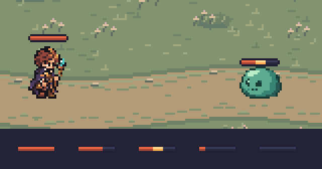

# 머리 위 체력바

마법사와 몬스터 머리 위에 띄우는 20×4px 체력바다. 모든 캐릭터가 같은 디자인을 쓴다. 빨간 채움만 두면 초원 바닥과 초록 슬라임 위에서 묻히므로 1px 어두운 테두리와 빈 칸 트랙을 함께 그린다.

| 파일 | 크기 | 용도 |
| --- | --- | --- |
| `hp-frame.png` | 20×4 | 테두리와 빈 칸 트랙. 네 모서리는 투명 |
| `hp-fill.png` | 18×2 | 현재 체력. 위 줄 밝은 빨강, 아래 줄 어두운 빨강 |
| `hp-chip.png` | 18×2 | 방금 깎인 구간의 노란 잔상 |

## 배치

- 그리기 순서는 `hp-frame` → `hp-chip` → `hp-fill`이다. 채움과 잔상은 프레임 좌상단 기준 (1, 1)에 놓는다.
- 채움 너비는 `round(18 × 현재체력 / 최대체력)`px이며, 체력이 0보다 크면 최소 1px을 남긴다. Unity에서는 SpriteRenderer의 Draw Mode를 Tiled 대신 Simple로 두고 피벗을 왼쪽 가운데로 맞춘 뒤 x 크기만 바꾸거나, UI Image의 Filled Horizontal을 쓴다. 정수 픽셀 너비로 맞춰 반 픽셀 번짐을 막는다.
- 바 좌상단의 위치는 발 피벗 기준 오프셋이다. 마법사 (-10, -32), 초원 슬라임 (-10, -27). 머리 꼭대기와 바 사이 간격은 2px이다. 전투 화면처럼 슬라임을 75%로 표시할 때는 y 오프셋에만 배율을 곱하고(-20), 바 자체는 1배로 그린다.
- 32 PPU, Filter Mode = Point, Compression = None.

## 동작

- 피해를 받으면 채움을 즉시 줄이고, 잔상은 이전 체력 너비로 350ms 유지한 뒤 250ms 동안 현재 체력까지 줄인다.
- 몬스터는 체력이 가득할 때 바를 숨기고 처음 피해를 받으면 표시한다. 마법사는 항상 표시한다.
- 사망 상태로 바뀌면 바를 바로 숨긴다.

값은 [매니페스트](manifest.json)에 있다. `build.py`로 PNG·매니페스트·미리보기를 다시 만든다.
